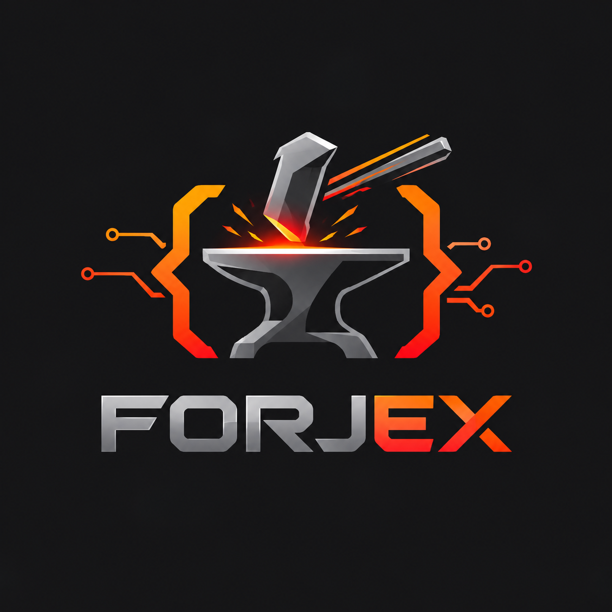

# 🚀 Forjex | Desenvolvimento Web & Soluções Tecnológicas

<div align="center">
  
  <p><b>Forjando o futuro digital do seu negócio através de alta performance, design exclusivo e arquitetura moderna.</b></p>
</div>

<p align="center">
  <a href="#-sobre-o-projeto">Sobre</a> •
  <a href="#-tecnologias">Tecnologias</a> •
  <a href="#-funcionalidades">Funcionalidades</a> •
  <a href="#-estrutura-do-projeto">Estrutura</a> •
  <a href="#-como-executar">Como Executar</a>
</p>

---

## 💡 Sobre o Projeto

A **Forjex** é uma iniciativa especializada em desenvolvimento web de alta performance, criação de landing pages de conversão, interfaces limpas com foco em UI/UX e automações inteligentes sob medida para empresas que desejam escalar no ambiente digital.

---

## 🛠️ Tecnologias Utilizadas

O projeto foi desenvolvido com tecnologias modernas e padrões de mercado, priorizando leveza, velocidade e interatividade:

* **HTML5 & CSS3**: Estrutura semântica e estilização customizada com design system em tons de cobre e glassmorphism.
* **JavaScript (ES6+)**: Manipulação de DOM, menus responsivos e lógica de integração com WhatsApp.
* **WebGL / Particle Drift**: Motor gráfico em tempo real integrado na seção principal para criar um fundo interativo com rastreamento de ponteiro.
* **Font Awesome & Google Fonts**: Ícones modernos (Inter font).

---

## ✨ Funcionalidades

* 📱 **Layout 100% Responsivo**: Adaptado perfeitamente para computadores, tablets e smartphones.
* 🌌 **Fundo Interativo WebGL**: Animação fluida de partículas que reagem ao movimento do cursor.
* 💳 **Cards 3D Flutuantes**: Elementos visuais em perspectiva tridimensional imersiva simulando logs de servidor, código e métricas em tempo real.
* 💬 **Orçamento Direto via WhatsApp**: Formulário interativo com captação de dados do cliente e redirecionamento automatizado para atendimento instantâneo.
* 🔗 **Links de Portfólio Dedicados**: Acesso rápido tanto para as aplicações em funcionamento quanto para os repositórios no GitHub.

---

## 📂 Estrutura do Projeto

```text
forjex/
├── index.html       # Página principal estruturada
├── style.css        # Estilos globais, glassmorphism e design system
├── script.js        # Lógica do menu, formulário WhatsApp e motor WebGL
└── logo/
    └── logo.png     # Logotipo oficial da Forjex